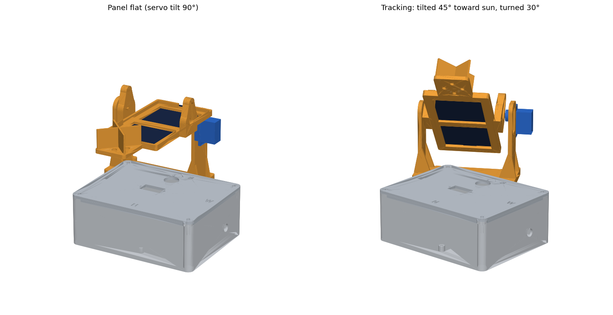
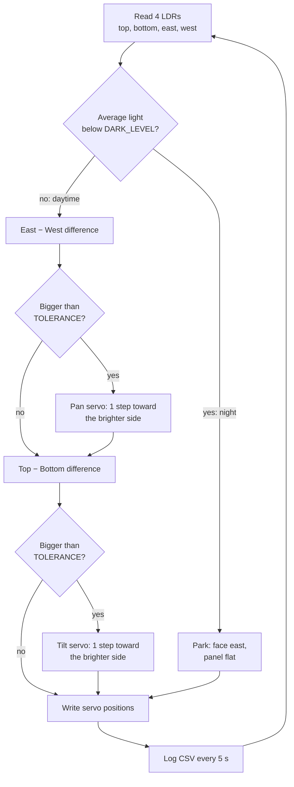
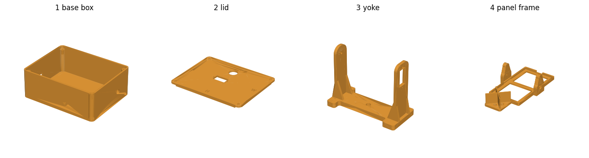
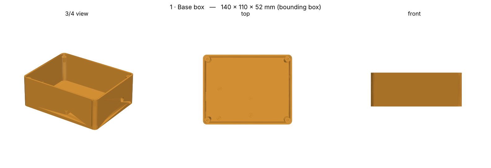
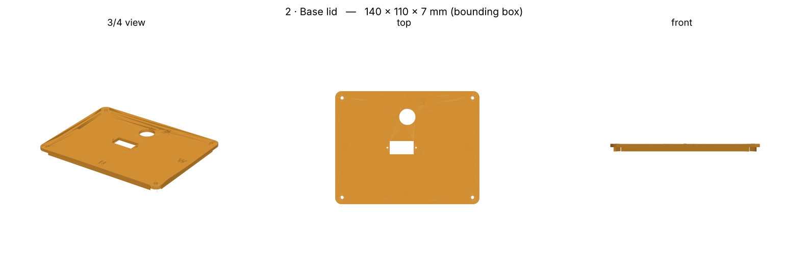
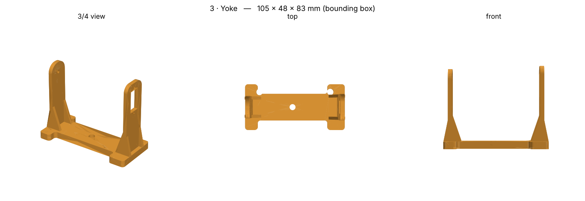
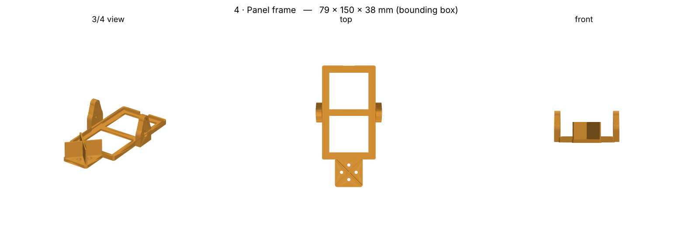
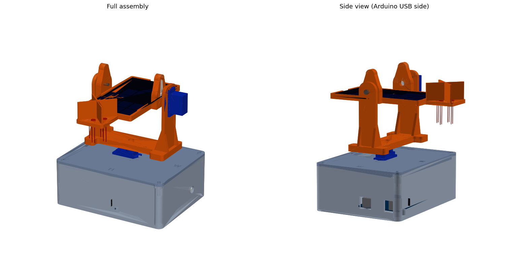

# Dual-Axis Solar Tracker (Arduino)

A small solar panel that turns by itself to face the sun. Four light sensors (LDRs) tell an Arduino where the sun is, and two servo motors move the panel on two axes: **east–west (pan)** and **up–down (tilt)**. The whole mechanical structure is 3D-printed and designed in parametric CAD.

Made for the *Gylymi Joba* science project competition (engineering category).

> **Project question:** how much more energy does a panel that follows the sun produce than the same panel fixed in place?



*Left: panel flat (both servos at 90°). Right: the same model tracking – tilted 45° toward the sun and turned 30°.*

---

## Contents

1. [How it works](#how-it-works)
2. [Bill of materials](#bill-of-materials)
3. [The CAD model](#the-cad-model) – every part explained
4. [Electronics and wiring](#electronics-and-wiring)
5. [The firmware](#the-firmware) – line-by-line logic
6. [Printing](#printing)
7. [Assembly](#assembly)
8. [Calibration](#calibration)
9. [Experiment plan](#experiment-plan)
10. [Customising the CAD](#customising-the-cad)
11. [Known limitations and to-do](#known-limitations-and-to-do)
12. [Repository layout](#repository-layout)

---

## How it works

A fixed panel only faces the sun directly for a short part of the day. When sunlight hits a panel at an angle, less light lands on it, so it produces less power. The tracker keeps the panel pointed at the sun all day.

It does this with a simple feedback loop, repeated about 30 times per second:



**The sensor head is the key idea.** The four LDRs sit in a small cross-shaped holder. An X-shaped wall divides it into four quadrants. If the sun is exactly in front, all four LDRs get the same light. If the sun is off to one side, the divider casts a shadow on the opposite LDR, so the readings become different. The Arduino turns the panel until the readings match again – at that moment the panel points at the sun.

---

## Bill of materials

| Qty | Part | Notes |
|---|---|---|
| 1 | Arduino Uno | sits on 4 standoffs inside the base box |
| 2 | SG90 micro servo | one for pan (east–west), one for tilt (up–down) |
| 4 | LDR, 5 mm | light sensors |
| 4 | 10 kΩ resistor | one per LDR (voltage divider) |
| 2 | 10 kΩ resistor | voltage divider to measure the panel (A4) |
| 1 | Mini solar panel, 110 × 60 × 3 mm | the CAD is sized to this – see [customising](#customising-the-cad) |
| 1 | Mini breadboard | fits in the base box |
| 1 | M3 × 16 bolt + washer | tilt pivot on the second yoke arm |
| – | 4× AA pack or USB power bank | recommended separate 5 V supply for the servos |
| – | PLA or PETG filament | about 4 printed parts |
| – | Jumper wires, hot glue / double-sided tape, servo screws | |

---

## The CAD model

The model is **parametric**: it is written as a Python script ([`cad_source/tracker.py`](cad_source/tracker.py)) using [CadQuery](https://cadquery.readthedocs.io/). Change a number at the top of the script, run it, and all STL/STEP files are regenerated.

- **STL** files ([`cad/stl`](cad/stl)) are for slicing and printing.
- **STEP** files ([`cad/step`](cad/step)) open in Fusion 360, SolidWorks, FreeCAD, etc. so you can edit them.
- The full assembly with servos, Arduino, panel and LDRs is in [`cad/assembly`](cad/assembly) (`.step` and `.glb`). The `.glb` opens in any 3D viewer.

### All four printed parts



### How the parts stack together

```
        panel + LDR sensor head
              │  ┌── tilt servo (SG90) on the yoke's tall arm
        4  PANEL FRAME  ── tilts up/down (east–west axis)
              │
        3  YOKE         ── rotates east/west on the pan servo
              │
        2  BASE LID     ── holds the pan servo
              │
        1  BASE BOX     ── holds Arduino + breadboard
```

### 1 · Base box — 140 × 110 × 52 mm



The housing for the electronics.

- **4 standoffs** (6 mm tall, with 2.5 mm holes) match the Arduino Uno mounting holes.
- **Two windows in one wall** line up with the Uno's USB-B port and DC power jack, so you can upload code and power the board without opening the box.
- **A round wire hole** (9 mm) on the opposite wall for the solar panel's output wires or an external 5 V supply.
- **Four corner bosses** with small holes, for the lid screws.
- Print with the open side up, no supports.

### 2 · Base lid — 140 × 110 × 7 mm



A flat lid with a lip that fits inside the walls.

- **Rectangular slot** in the middle: the **pan SG90 servo** drops in from above and is screwed to the lid through its mounting tabs. The servo shaft ends up exactly at the centre of the pan axis.
- **Round hole** (16 mm) near the middle for the servo, LDR and panel cables to go down into the box.
- **Engraved compass marks**: an arrow and **S** at the south side, plus **N / E / W**. Place the tracker outside with the arrow pointing south. The firmware and the LDR positions depend on this.
- Print upside down (lip pointing up), no supports.

### 3 · Yoke — 105 × 48 × 83 mm



The U-shaped bracket that is **rotated by the pan servo** and carries the tilt axis.

- **Base plate** with a recess in the underside for the **double-arm servo horn**, and a centre hole for the horn screw.
- **Tall arm (+X side)** with a cut-out where the **tilt servo** is mounted from the outside, shaft pointing inward.
- **Short arm (−X side)** with a 3.4 mm hole for the **M3 pivot bolt**. This is the free end of the tilt axis.
- **Gussets** (triangular ribs) on both arms so the thin arms do not flex.
- The tilt axis is 62 mm above the plate, which leaves room for the panel frame to swing (`cad_source/check.py` tests this for collisions).
- Print plate-down, no supports.

### 4 · Panel frame — 79 × 150 × 38 mm



Holds the solar panel and the light sensors, and **tilts on the yoke**.

- **Tray** sized to the panel (110 × 60 mm plus 0.3 mm clearance per side) with a window underneath so the panel can be pushed out, and finger notches at both ends.
- **Two lugs** on the sides form the tilt axis. One has a recess for the **single-arm servo horn** (points up); the other has a hole for the **M3 bolt**.
- **Sensor head** on one end: a square plate with an **X-shaped shadow wall** and **four 5.4 mm holes** for the LDRs, arranged top / bottom / east / west.
- Print flat (tray floor on the bed), no supports.

### Full assembly with electronics



*Orange: printed parts. Blue: servos. Grey: base box and lid. The side view on the right shows the Arduino's USB and power windows.*

---

## Electronics and wiring

### Pin map

| Arduino pin | Connected to | Purpose |
|---|---|---|
| A0 | LDR **top** (farthest from the panel) | tilt sensing |
| A1 | LDR **bottom** (closest to the panel) | tilt sensing |
| A2 | LDR **east** (lid's "E" side) | pan sensing |
| A3 | LDR **west** (lid's "W" side) | pan sensing |
| A4 | Panel voltage divider | measuring output |
| D9 | Pan servo signal | east–west motion |
| D10 | Tilt servo signal | up–down motion |
| 5V / GND | Servos, LDR dividers | power (see note) |

### Each LDR (×4)

```
5V ─── LDR ───┬─── analog pin (A0…A3)
              │
             10 kΩ
              │
             GND            more light  →  bigger number
```

### Panel voltage monitor

```
Panel + ─── 10 kΩ ───┬─── 10 kΩ ─── GND        Panel − to GND
                     │
                     A4          (measures up to 10 V; the sketch multiplies by 2)
```

The divider halves the voltage so a panel up to 10 V stays inside the Arduino's 5 V input limit.

### Power

Servos draw bursts of current. Powering both from the Arduino's 5 V pin can cause resets and jitter. It is better to use a separate 5 V supply (4×AA or a power bank) for the servos and **connect its GND to the Arduino GND**.

---

## The firmware

File: [`firmware/solar_tracker/solar_tracker.ino`](firmware/solar_tracker/solar_tracker.ino). It only needs the standard `Servo` library that ships with the Arduino IDE.

### Settings you can tune

| Constant | Default | What it does |
|---|---|---|
| `PAN_DIR`, `TILT_DIR` | `1` | Set to `-1` if a servo moves the wrong way (see [calibration](#calibration)) |
| `TOLERANCE` | `25` | Differences smaller than this are ignored. Higher = less jitter, lower accuracy |
| `DARK_LEVEL` | `60` | If the average of all four LDRs is below this, it is "night" |
| `PAN_MIN` / `PAN_MAX` | `0` / `180` | Pan range. **90° = facing south** |
| `TILT_MIN` / `TILT_MAX` | `0` / `140` | Tilt range. **90° = panel flat** |
| `STEP_DELAY` | `30` ms | Delay per loop. Bigger = slower, smoother movement |
| `LOG_EVERY` | `5000` ms | How often a data line is printed |

### What each part of the code does

1. **`readAvg(pin)`** reads a pin 8 times and averages it. This removes noise from the analog readings.
2. **`setup()`** attaches both servos and moves them to 90°, which is also the position you need for mounting the horns. It then prints the CSV header.
3. **`loop()`**
   - Reads the four LDRs and computes their average.
   - **Night:** if the average is below `DARK_LEVEL`, park facing east (pan near its east limit, tilt flat) so the panel is ready for sunrise.
   - **Day:** compute `east − west` and `top − bottom`. If a difference is larger than `TOLERANCE`, move that servo **one degree** toward the brighter side. Positions are limited with `constrain()`.
   - Writes both servo positions.
   - Every 5 s prints one CSV line: `time_s, top, bottom, east, west, pan, tilt, panel_V`.

Moving only one degree per loop makes the motion smooth and prevents the "hunting" (back-and-forth shaking) you get when a controller jumps straight to a target.

### Data log

Open the Serial Monitor at **9600 baud** and you will get lines like:

```
time_s,top,bottom,east,west,pan,tilt,panel_V
```

Copy them into a spreadsheet to plot light levels, servo angles and panel voltage over time.

---

## Printing

| Setting | Value |
|---|---|
| Material | PLA or PETG |
| Layer height | 0.2 mm |
| Walls | 3 |
| Infill | 20–25 % |
| Supports | none needed for any part |

| Part | Orientation on the bed |
|---|---|
| 1 Base box | open side **up** |
| 2 Base lid | **upside down** (lip up) |
| 3 Yoke | plate **down** |
| 4 Panel frame | flat, tray floor on the bed |

---

## Assembly

1. Put the **Arduino Uno** on the 4 standoffs in the box (USB toward its windows).
2. Drop the **pan SG90** into the lid slot from above. The tabs rest on the lid. Fix with the servo screws. The lid arrow = **south**.
3. **Upload the sketch once**: it sets both servos to 90°. Do this **before** fitting any horn.
4. Fit the **double-arm horn** on the pan servo. Press the yoke's underside recess onto it with the arms pointing east–west. Fix with the horn centre screw through the small hole in the yoke plate.
5. Put the **tilt SG90** into the tall arm from outside, shaft pointing inward and shaft end **up**.
6. Put the **single-arm horn** on the tilt servo pointing **up**, press the panel frame lug onto it with the panel flat, and fix with the centre screw.
7. On the other side: an **M3 × 16 bolt + washer** through the short arm into the frame lug (a 3 mm nail or piece of filament also works as a pin).
8. Put the **solar panel** into the frame (hot-glue dots or double-sided tape). Run its wires out through the window.
9. Push the **4 LDRs** into the holes of the sensor cross, legs through, and wire them as in the [pin map](#pin-map).
10. Route all servo, LDR and panel wires **down through the lid hole**, leaving slack so the head can turn.

> If a horn does not sit fully in its recess (servo brands differ by about 1 mm), add a washer or thin shim, or lightly sand the recess face.

---

## Calibration

Do this once, with a phone flashlight:

1. Upload the sketch and open the Serial Monitor at 9600 baud.
2. Shine the light from the **east**. The pan must turn toward it. If it turns away, set `PAN_DIR = -1`.
3. Shine the light from **above / in front**. The tilt must move toward it. If it moves away, set `TILT_DIR = -1`.

**About the tilt range:** the sensor head is at the **north** end of the panel. When the panel faces south, that end tilts **up**, so the useful servo range is the side that raises the head. The other side can only go about 50° past flat before the head reaches the base (the sketch limits this with `TILT_MAX = 140`). If the head touches the base near 140, change the range to `40` and `180`, as noted in the sketch.

For reference, at Aktobe's latitude (about 50° N) the midday sun is about 16° above the horizon in December and about 63° in June, so the panel needs to tilt roughly 27° to 74° from flat at noon through the year.

---

## Experiment plan

To answer the project question, compare the tracker with an identical fixed panel:

1. Build a **second, identical panel** on a fixed stand facing south at a fixed tilt.
2. Log both panels' voltages every few minutes for a full sunny day.
3. Compare the two curves and the total over the day.
4. Repeat on different days (clear sky vs cloudy) and report the difference.

**Two things to fix before you run this experiment** (details in the next section):

- The sketch currently logs only **A4** (the tracker's panel). The fixed panel needs its own divider on **A5** and a matching line in the sketch.
- Voltage alone is not energy. Put the same **fixed load resistor** across each panel (and measure the voltage across it) so that power = V² / R can be compared fairly, then add up over time.

---

## Customising the CAD

Install CadQuery and run the script:

```bash
pip install cadquery
cd cad_source
python tracker.py        # writes STL + STEP to cad_source/out/
python assembly.py       # writes the full assembly (needs check.py in the same folder)
```

Parameters are at the top of [`tracker.py`](cad_source/tracker.py):

| Parameter | Meaning |
|---|---|
| `PANEL_W, PANEL_L, PANEL_T` | solar panel size (default 60 × 110 × 3 mm) |
| `CLR` | printing clearance per side (0.3 mm) |
| `SG_*` | SG90 servo dimensions |
| `HORN_GAP`, `HORN_RECESS` | spacing and depth for the servo horns |
| `BOX_X, BOX_Y, BOX_H` | base box size |
| `WALL`, `FLOOR`, `LID_T` | wall thicknesses |
| `PIVOT_H`, `PLATE_T`, `LUG_T` | yoke and tilt-axis dimensions |

Other files in `cad_source/`: `check.py` (assembly positions and collision checks), `assembly.py` (full model with servos, Arduino, panel, LDRs), `render.py` and `render_full.py` (preview images).

---

## Known limitations and to-do

- **Not yet test-printed.** All dimensions are based on typical SG90, Arduino Uno and 5 mm LDR sizes. Servo brands and printers vary by about a millimetre, so expect to sand or shim the first print.
- **Panel size is assumed** (110 × 60 × 3 mm). Change `PANEL_*` if yours differs.
- **Firmware was written but not compiled or run on hardware here.** Test the calibration steps first.
- **Logging only covers the tracker panel (A4).** See the [experiment plan](#experiment-plan).
- **Voltage is not power.** Add a fixed load and compare V²/R.
- **Servos on Arduino 5 V** can brown out the board; use a separate supply.
- **No weatherproofing.** For outdoor days add a cover over the electronics and seal the wire holes.
- **No licence chosen yet.** Add a `LICENSE` file when you decide how others may reuse the project.

---

## Repository layout

```
dual-axis-solar-tracker/
├── README.md
├── cad/
│   ├── stl/            4 printable parts (.stl)
│   ├── step/           4 editable parts (.step)
│   └── assembly/       full assembly (.step, .glb)
├── cad_source/         parametric CadQuery scripts
│   ├── tracker.py      the four parts + export
│   ├── check.py        positions + collision checks
│   ├── assembly.py     full assembly with electronics
│   └── render*.py      preview renders
├── firmware/
│   └── solar_tracker/solar_tracker.ino
└── docs/images/        screenshots used in this README
```
